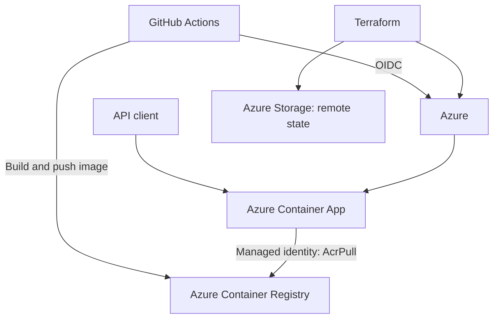

# EKFC Field Support API POC

A small Node.js API deployed to Azure Container Apps. This proof of concept demonstrates Terraform, GitHub Actions, and OIDC-based deployment to Azure.

It is a deployment demo, not a complete field-support product. Ticket data is stored in memory and is lost when the app restarts.

## Architecture



The application resources are created in the existing resource group `ekfc-fs-dev-rg`. Terraform creates the registry, Log Analytics workspace, Container Apps environment, managed identity, role assignment, and Container App.

Terraform state is stored separately in Azure Blob Storage. The state store is bootstrapped separately because Terraform needs a backend before it can store the main infrastructure state there.

## API

| Method | Endpoint | Purpose |
|---|---|---|
| `GET` | `/health` | Returns the API health status |
| `GET` | `/api/info` | Returns the API name, version, and environment |
| `GET` | `/api/tickets` | Lists tickets held in memory |
| `POST` | `/api/tickets` | Creates a ticket held in memory |

Example request:

```json
{
  "title": "Printer is offline",
  "description": "The warehouse printer is not responding.",
  "priority": "high"
}
```

A ticket requires a title and description. Priority can be `low`, `normal`, or `high`; it defaults to `normal`.

## CI/CD

The workflow is `.github/workflows/deploy.yml`.

- Pull requests run the API tests and Terraform format and validation checks. They do not access Azure.
- Pushes to `main` run the checks, create and apply a Terraform plan, build and push the API image to ACR, and update the Container App.
- GitHub Actions authenticates to Azure using OIDC. No Azure client secret is stored in the repository.
- After deployment, the workflow checks `/health` and publishes the API URLs in the Actions run summary.

This is a nonproduction POC. A push to `main` automatically applies Terraform and deploys the API.

## Run locally

Requirements: Node.js 22 or later.

Run the API:

```bash
npm start
```

In another terminal, check the endpoints:

```bash
curl http://localhost:3000/health
curl http://localhost:3000/api/info
curl http://localhost:3000/api/tickets
```

Run the automated tests:

```bash
npm test
```

Docker is optional for local development. To build and run the container, Docker must be installed:

```bash
docker build -t field-support-api:local .
docker run --rm -p 3000:3000 field-support-api:local
```

## Azure and GitHub configuration

The workflow reads these repository Actions variables:

| Variable | Purpose |
|---|---|
| `AZURE_CLIENT_ID` | Client ID of the GitHub deployment identity |
| `AZURE_TENANT_ID` | Microsoft Entra tenant ID |
| `AZURE_SUBSCRIPTION_ID` | Azure subscription ID |
| `AZURE_LOCATION` | Azure region; defaults to `uaenorth` |
| `RESOURCE_PREFIX` | Resource naming prefix; defaults to `ekfc-fs` |
| `TFSTATE_RESOURCE_GROUP` | Resource group containing the Terraform state account |
| `TFSTATE_STORAGE_ACCOUNT` | Storage account containing the Terraform state |

The deployment identity needs access to the app resource group, the state storage account, and the role assignment Terraform creates for Container Apps to pull from ACR. Keep permissions scoped as narrowly as the setup allows.

The Terraform state store is created separately under `infra/bootstrap-state`. Do not run its `apply` again unless you are intentionally creating or updating the state store.

## Deployed API

Base URL:

[https://ekfc-fs-1klw0-api.blueground-f89c31e6.uaenorth.azurecontainerapps.io](https://ekfc-fs-1klw0-api.blueground-f89c31e6.uaenorth.azurecontainerapps.io)

- [Health](https://ekfc-fs-1klw0-api.blueground-f89c31e6.uaenorth.azurecontainerapps.io/health)
- [API info](https://ekfc-fs-1klw0-api.blueground-f89c31e6.uaenorth.azurecontainerapps.io/api/info)
- [Tickets](https://ekfc-fs-1klw0-api.blueground-f89c31e6.uaenorth.azurecontainerapps.io/api/tickets)

The ticket endpoint is a demo only. It has no database, so tickets do not persist across app restarts or deployments.

## Evidence

Before submitting the POC, add screenshots of the successful GitHub Actions run and the API responses under `docs/screenshots/`, then link them here.

## Cost and cleanup

Container Apps can scale to zero, but the registry, Log Analytics workspace, and Terraform state storage may still incur charges. Check Azure Cost Management while the POC is running.

When finished, destroy the app infrastructure using Terraform with the existing remote backend. The separate state resource group and storage account are not removed by the main Terraform configuration. Keep them if you need the Terraform state; remove them only when you no longer need the state store.