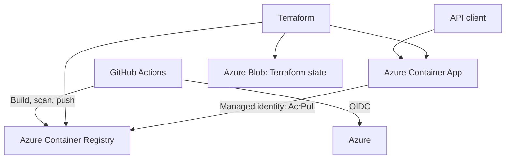

# EKFC Field Support API POC

A small Node.js API deployed to Azure Container Apps. This nonproduction proof of concept demonstrates Terraform, GitHub Actions, GitHub OIDC authentication, container image scanning, and Azure deployment.

Tickets are stored in Azure Table Storage. The app uses a managed identity and Microsoft Entra authorization; no storage key is used by the API. Local runs use an in-memory store, so local ticket data is temporary.

## Architecture



Terraform manages the application resource group `ekfc-fs-dev-rg`, Azure Container Registry, Log Analytics workspace, Container Apps environment, separate managed identities for ACR pull and ticket data, the ticket storage account and role assignment, and Container App.

Terraform state is kept in a separate Azure Storage account. The state account is bootstrapped separately because the remote backend must exist before the application Terraform can use it.

## API

| Method | Endpoint | Purpose |
|---|---|---|
| `GET` | `/health` | Returns `{"status":"ok"}` |
| `GET` | `/api/info` | Returns the API name, package version, deployed commit, and environment |
| `GET` | `/api/tickets` | Lists tickets stored in Azure Table Storage in Azure; local runs use memory |
| `POST` | `/api/tickets` | Creates a ticket in Azure Table Storage in Azure; local runs use memory |

Example ticket request:

```json
{
  "title": "Printer is offline",
  "description": "The warehouse printer is not responding.",
  "priority": "high"
}
```

A title and description are required. Priority is optional and can be `low`, `normal`, or `high`; it defaults to `normal`.

## CI/CD

The workflows are:

- `.github/workflows/build.yml` runs API tests, Terraform formatting and validation for both Terraform roots, Checkov, and Trivy configuration scanning. Pull requests run checks without Azure credentials.
- `.github/workflows/deploy-dev.yml` calls the checks, creates a Terraform plan, waits for approval in the `dev-apply` GitHub Environment, checks that the plan has not changed, then applies it. It builds and scans the API image, pushes it to ACR, deploys it, and checks the live API response.
- Images are tagged with the Git commit SHA. `/api/info` returns that commit, and the deployment workflow verifies it.
- GitHub Actions authenticates to Azure using OIDC. No Azure client secret is stored in the repository.

The Terraform plan is published in the Actions run summary before the apply job. The apply job recalculates the plan after approval and compares its resource changes with the reviewed plan. If they differ, apply stops and the new plan must be reviewed.

### Security scan policy

Checkov and Trivy fail the workflow on new findings. The existing, visible POC exceptions are listed with their rationale in [docs/security-exceptions.md](docs/security-exceptions.md). Trivy's `AZU-0012` exception is scoped to the state account and application storage account files; private networking is needed to remove it.

The image scan blocks on HIGH and CRITICAL vulnerabilities. Review and update the exception list when the POC architecture changes. The application table account needs a public endpoint because the Container Apps environment has no private network connection; its Trivy exception is scoped in `.trivyignore.yaml`.

This POC has a dev environment only. Pushes to `main` automatically start the workflow; the `dev-apply` environment approval must be configured before Terraform can apply.

## One-time Azure and GitHub setup

Use a dedicated POC subscription or resource group. These commands bootstrap the state account once; they do not create the application resources.

```powershell
az login
az account set --subscription "<AZURE_SUBSCRIPTION_ID>"

terraform -chdir=infra/bootstrap-state init
terraform -chdir=infra/bootstrap-state validate
terraform -chdir=infra/bootstrap-state plan -var="subscription_id=<AZURE_SUBSCRIPTION_ID>"
```

Review the plan before creating the state account:

```powershell
terraform -chdir=infra/bootstrap-state apply -var="subscription_id=<AZURE_SUBSCRIPTION_ID>"
terraform -chdir=infra/bootstrap-state output -raw state_storage_account_name
```

Save the storage account name returned by the last command. Create or use a GitHub Actions identity with these two federated credentials:

- Subject for plan and deployment jobs: `repo:<OWNER>/<REPO>:ref:refs/heads/main`
- Subject for the approval-gated apply job: `repo:<OWNER>/<REPO>:environment:dev-apply`
- Issuer for both: `https://token.actions.githubusercontent.com`
- Audience for both: `api://AzureADTokenExchange`

Assign the GitHub Actions identity these roles:

- `Contributor` on `ekfc-fs-dev-rg` to manage application resources.
- `User Access Administrator` on `ekfc-fs-dev-rg` so Terraform can create the `AcrPull` role assignment for the Container App identity.
- `AcrPush` on the Azure Container Registry to push the API image.
- `Storage Blob Data Contributor` on the state storage account to access Terraform state.

The Container App uses a separate managed identity with `AcrPull` on ACR and `Storage Table Data Contributor` on its ticket storage account. Terraform creates these app identity assignments.

Keep each assignment scoped to the resource group or resource listed above.

Add these repository Actions variables under **Settings → Secrets and variables → Actions → Variables**:

| Variable | Purpose |
|---|---|
| `AZURE_CLIENT_ID` | Client ID of the GitHub deployment identity |
| `AZURE_TENANT_ID` | Microsoft Entra tenant ID |
| `AZURE_SUBSCRIPTION_ID` | Azure subscription ID |
| `TFSTATE_RESOURCE_GROUP` | Resource group containing the state account |
| `TFSTATE_STORAGE_ACCOUNT` | Name returned by the bootstrap Terraform output |

Create a GitHub Environment named `dev-apply` under **Settings → Environments**. Add yourself (or a trusted reviewer) under **Required reviewers**, save the protection rule, and restrict deployment branches to `main`. The approval gate will not pause deployments until a required reviewer is configured.

Dev application settings are in `infra/dev.tfvars`; it contains no credentials. The deployment workflow handles remote state initialization.

The state store lives under `infra/bootstrap-state`. Do not apply that configuration again unless you intend to manage the state store itself.

## Run locally

Requirements: Node.js 22 or later.

Start the API:

```bash
npm start
```

In another terminal:

```bash
curl http://localhost:3000/health
curl http://localhost:3000/api/info
curl http://localhost:3000/api/tickets
```

Run the API tests:

```bash
npm test
```

Docker is optional for local development. To build and run the container, install Docker first:

```bash
docker build -t field-support-api:local .
docker run --rm -p 3000:3000 field-support-api:local
```

## Design decisions and limits

- The state store and application infrastructure use separate Terraform roots so the remote state backend exists before the main stack initializes.
- The Container App uses a user-assigned managed identity to pull images from ACR; the ACR admin account stays disabled.
- The app uses Consumption workload profiles, scales from zero to two replicas, and has an HTTP request scaling rule. Scale-to-zero reduces idle compute use but may make the first request after inactivity slower.
- Azure stores tickets in a Standard LRS Table Storage account. The Container App accesses table data with a dedicated user-assigned identity and Entra ID; shared-key access is disabled. Local development falls back to memory storage.
- Ticket records remain available across app restarts and revisions. Destroying the Terraform-managed application resources also deletes the ticket storage account and its data.
- This demonstrates a dev deployment only. Terraform apply requires approval through the `dev-apply` GitHub Environment.

## Deployed API

Base URL:

[https://ekfc-fs-1klw0-api.blueground-f89c31e6.uaenorth.azurecontainerapps.io](https://ekfc-fs-1klw0-api.blueground-f89c31e6.uaenorth.azurecontainerapps.io)

- [Health](https://ekfc-fs-1klw0-api.blueground-f89c31e6.uaenorth.azurecontainerapps.io/health)
- [API info](https://ekfc-fs-1klw0-api.blueground-f89c31e6.uaenorth.azurecontainerapps.io/api/info)
- [Tickets](https://ekfc-fs-1klw0-api.blueground-f89c31e6.uaenorth.azurecontainerapps.io/api/tickets)

## Submission evidence

Deployment and API evidence is available in [docs/screenshots](docs/screenshots/README.md):

- [Successful main-branch deployment](docs/screenshots/actions-success.png)
- [Live /health response](docs/screenshots/api-health.png)
- [Live /api/info response](docs/screenshots/api-info.png)

The folder also contains screenshots of the Azure resources and Terraform state. Do not share screenshots that expose credentials or access tokens.

## Cost and cleanup

Container Apps can scale to zero, but ACR, Log Analytics, the ticket storage account, and Terraform state storage may still incur charges. Check Azure Cost Management while the POC is running.

When finished, destroy the application infrastructure using Terraform with the existing remote backend. The separate state resource group and storage account are not removed by the main Terraform configuration. Keep them while you need the Terraform state; remove them only when the POC is finished and the state is no longer needed.
