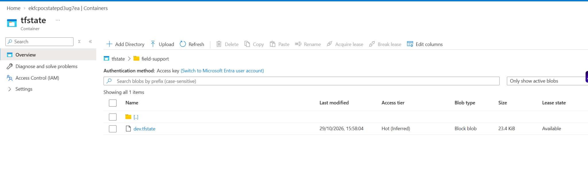
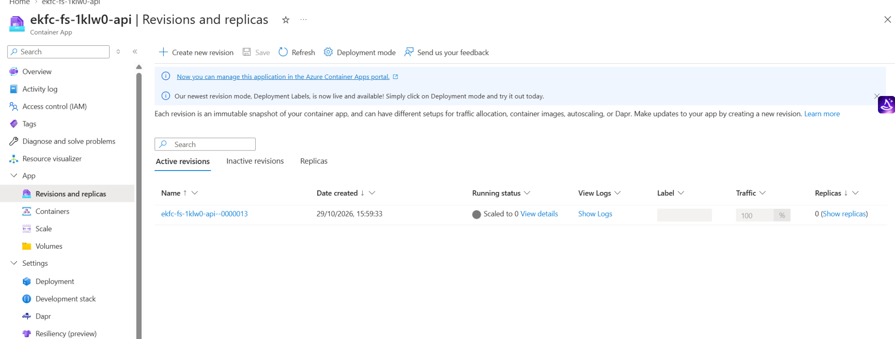
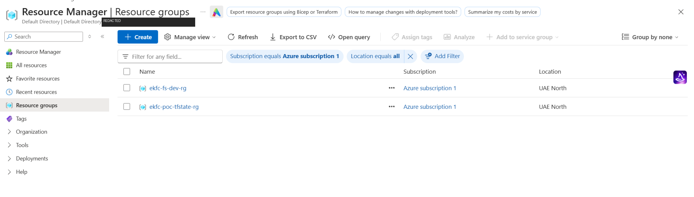
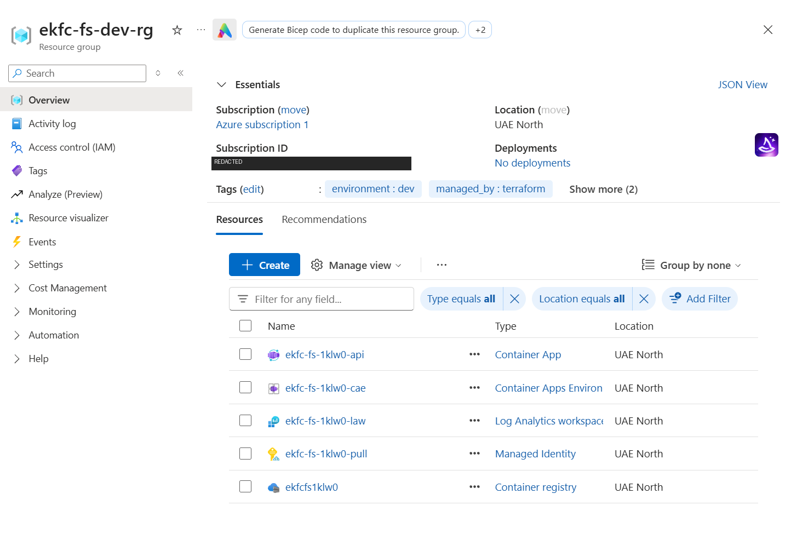
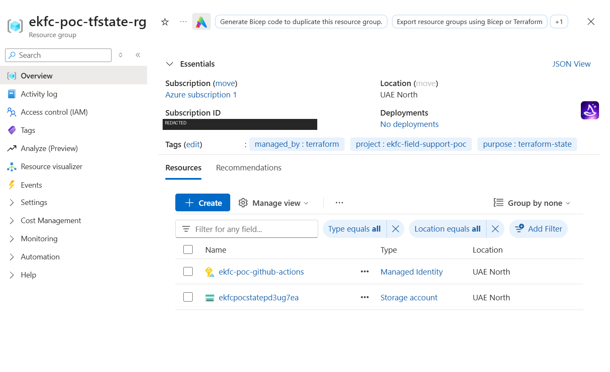
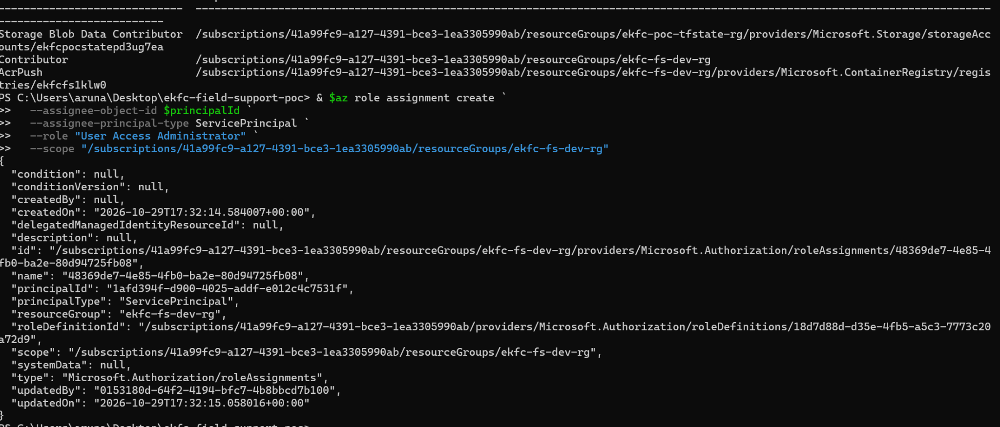

# POC evidence screenshots

These Azure screenshots show the resources used by the Field Support API POC. Account email and subscription IDs are redacted in the applicable images.

## Terraform remote state

The `tfstate` container contains the `dev.tfstate` state file.

## Container App revision

The Container App has an active revision and is scaled to zero while idle.

## Azure resource groups

The subscription contains separate application and Terraform state resource groups.

## Application resources

The application resource group contains the Container App, Container Apps environment, Log Analytics workspace, managed identity, and registry.

## Terraform state resources

The state resource group contains the managed identity and storage account.

## GitHub Actions identity

This screenshot shows the User Access Administrator assignment for the GitHub Actions identity at the application resource group scope.

## Deployment and API evidence

These screenshots document the successful main-branch deployment and live API responses:

- [GitHub Actions deployment](actions-success.png) — successful workflow run and job summary.
- [API health](api-health.png) — live `/health` response.
- [API information](api-info.png) — live `/api/info` response, including the deployed commit.
- [Ticket creation and retrieval](api-ticket-create-and-retrieve.png) — a ticket created with `POST /api/tickets` and returned by `GET /api/tickets`.

The Azure screenshots above document the application resources, remote state, and GitHub Actions identity. Do not include credentials or access tokens in screenshots.
